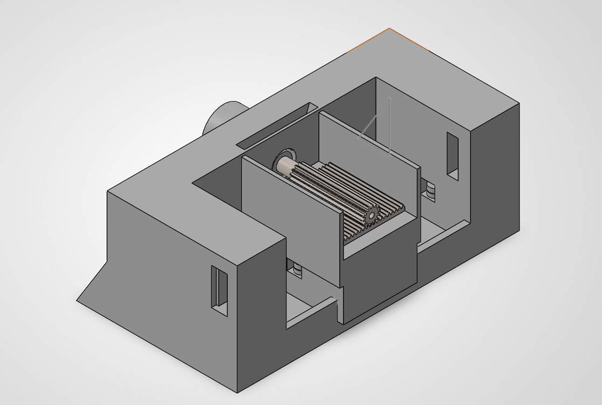

# Linear Motion Plant — Mechanical Design & CAD

Team project for a Linear Control Systems course at Universidad Militar Nueva Granada
(2026). A carriage moves along a guide driven by a DC motor, with a two-transistor power
stage built by the team.

## My role

Complete mechanical design and CAD in SolidWorks: housing, guide supports, motor mount
and internal ducting. The control system was developed jointly with the team.

## Design decisions

- Modeled around the **real dimensions** of the motor, shaft and guides instead of nominal
  values, so the parts fit without rework
- Designed for **FDM**: wall thickness, clearances and part orientation, with the printing
  outsourced to an external service
- **Two changes were needed during assembly** and both were folded back into the model
  instead of patched on the physical part

## Files

| File | Description |
|---|---|
| `render.png` | Isometric view of the assembly in SolidWorks |
| `photo.png` | The printed and assembled plant |

Tools: SolidWorks · DFM for FDM
